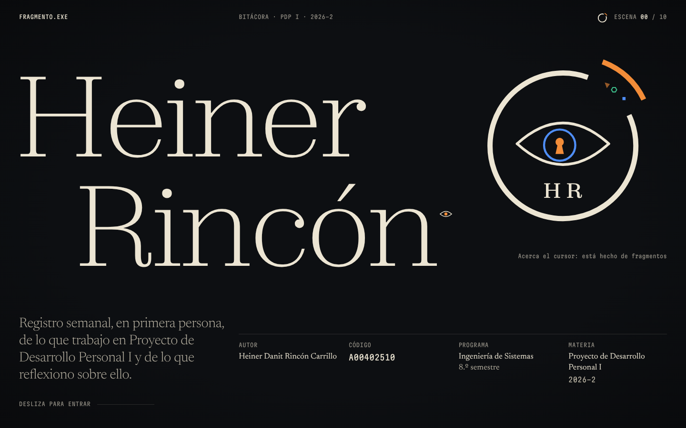
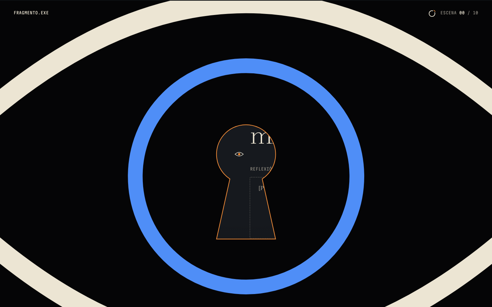
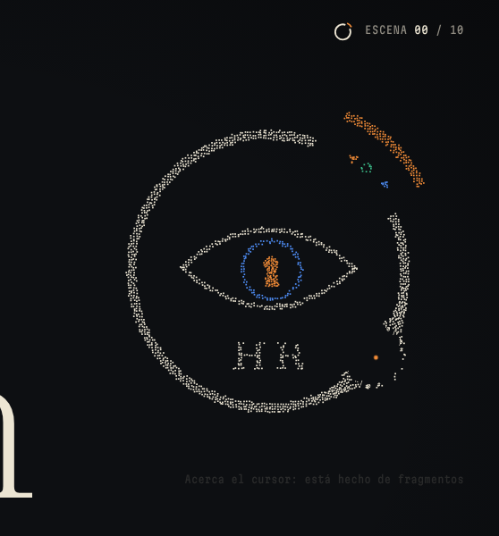
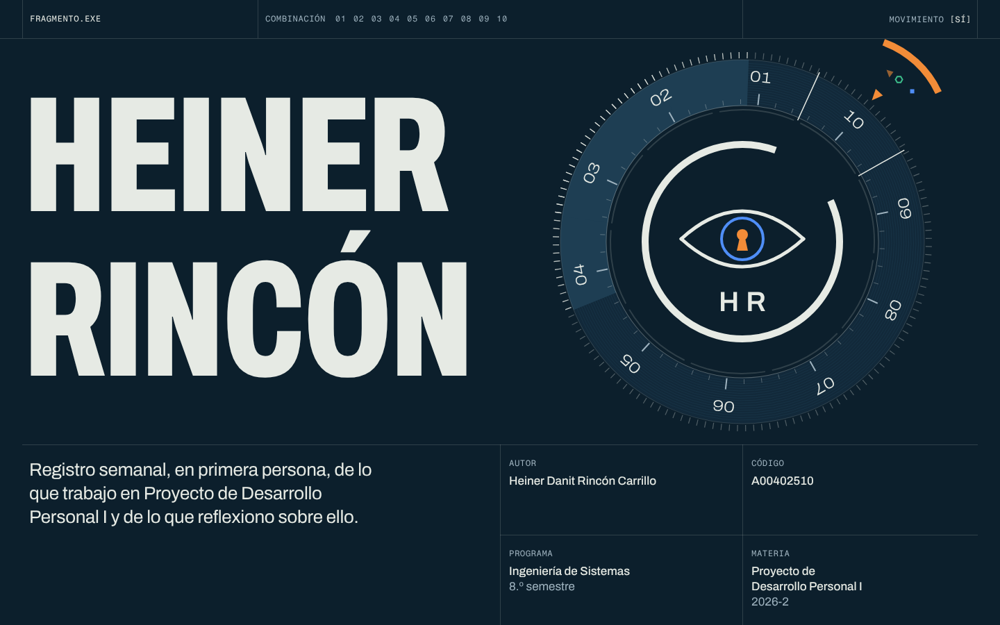
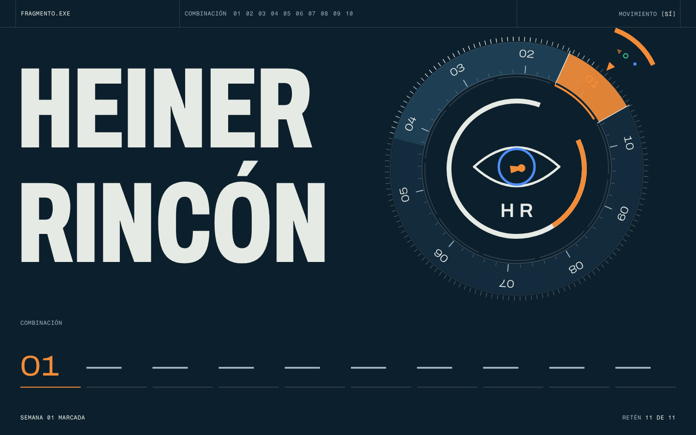
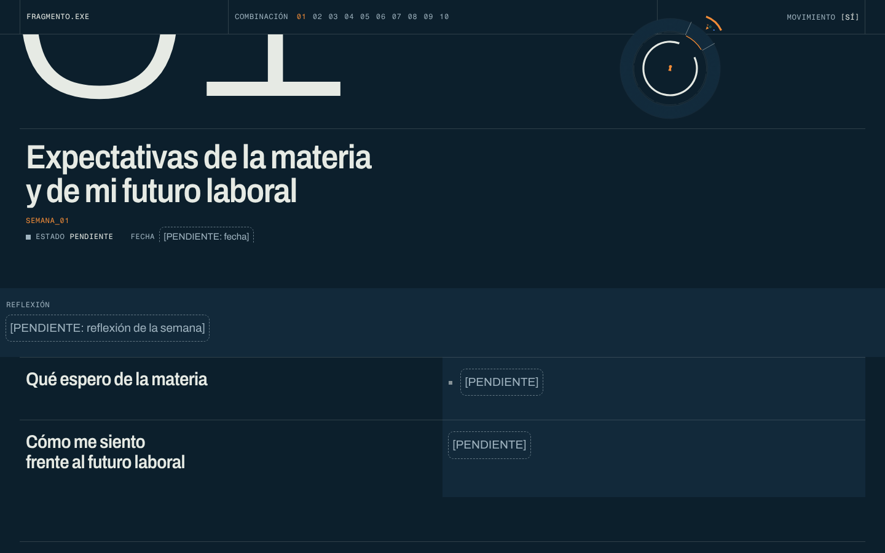

# Crítica final · Fase 1 · Prototipos A y B

> Crítico independiente, ronda 3 (final). Fecha: 16-oct-2026.
> Las notas se pusieron **antes** de leer `CRITICA-FASE1.md` y `CRITICA-FASE1-R2.md`. La comparación va en «Evolución», al final.
> El contenido `[PENDIENTE]` es así por diseño y no se califica: se juzga la composición.

## Método

- `revisar.mjs` en modo normal y `reduced`, a 1440 × 900 y 390 × 844 (48 capturas, todas revisadas). Sin errores de consola y sin scroll horizontal en ninguno de los dos.
- Scripts propios con Playwright: entrada a 0,5 / 1,5 / 3 s; 10 cuadros de scroll con rueda (140 px por cuadro) sobre el momento clave; hover sobre el símbolo; recorrido con Tab (8 pulsaciones); 360 × 740 táctil; fps durante 2 s de scroll continuo; PDF en tamaño carta.
- `impeccable critique` y `impeccable audit` en modo solo revisión. **Corrida degradada en un solo contexto**: esta sesión no tiene herramienta de subagentes, así que no se pudieron aislar las evaluaciones A y B como pide la skill. No se guardó snapshot ni se inyectó el overlay del navegador, porque `live-server` escribe una etiqueta `<script>` en el HTML y aquí no se podía tocar `site/`. El detector sí se corrió: `impeccable detect` y `detect --json` sobre cada `index.html` y cada carpeta.
- Se leyó el código para juzgar rendimiento, accesibilidad y reduced motion.

Capturas de trabajo: `/tmp/claude-0/-home-user-bitacora-pdp/07949875-9793-50ed-8e92-c1a87c5b208e/scratchpad/critica3/` (las de mis scripts propios están en `x/`). Capturas representativas guardadas en `docs/critica/final-*.png`.

---

## A · «Sala de observación»

### Notas

| Criterio | Nota | Justificación concreta |
|---|---|---|
| a) No parece plantilla / IA | **7,5** | La portada tiene autor (`final-a-01`): Zodiak casi hairline a unos 240 px, «Heiner / Rincón» escalonado y un *billing block* de afiche con tres voces (Zodiak, Newsreader y Martian). Ya no hay nube de puntos en reposo: el símbolo queda vectorial y nítido, y solo se deshace en partículas cuando el cursor se acerca (`final-a-03`). Eso corrige el peor tic de la ronda anterior. Lo que todavía se ve «de catálogo»: el «01» gigante en contorno hairline que después se rellena (`a-1440-030` → `a-1440-050`), muy visto en portafolios editoriales, y la pantalla del GIRO, que es la palabra «Giro» a 300 px con un recuadro abajo a la derecha (`a-1440-075`): es la plantilla de «palabra enorme + caja», no una escena. |
| b) Momento compartible | **9** | **Entrar por la cerradura.** Cuadro a cuadro (`x/a-scroll-01…10`): el nombre se abre como telón, el símbolo viaja al centro, el ojo crece, el iris azul llena la pantalla y por la pupila-cerradura, con borde naranja de 2 px, ya se ve la semana 01 (`final-a-02`). Después el círculo se abre y la cabecera queda quieta. Se entiende sin explicación y une ciberseguridad («ver lo que otros no ven») con metacognición (mirar hacia adentro). Hay un segundo momento: el símbolo se desarma en partículas que esquivan el cursor (`final-a-03`). |
| c) Concepto | **8,5** | Casi todo significa algo: partículas-glifo que arman el símbolo (fragmentos que vuelven al todo), el arco naranja que se arma aparte y flota (falta él), el iris que sigue al cursor (el observador observado), la cerradura como puerta, el mini-símbolo de la claqueta que avanza con la escena y el GIRO como revelación. **Decorativos:** el grano, la viñeta, la apertura del nombre como telón (bonita, pero no dice nada propio), la pista «Acerca el cursor: está hecho de fragmentos» (explica el truco en vez de dejar que se descubra) y el «01» en contorno. **Ritmo** y **crecimiento**, dos capas del brief, siguen casi ausentes. |
| d) Tipografía, ritmo, espaciado, detalle | **7,5** | La portada está al milímetro: líneas base del bloque de créditos alineadas, «8.º» correcto y código en mono. Fallos: (1) por la cerradura se ve el **borde derecho** de la cabecera («m», «REFLEXIÓ», «[P», `final-a-02`) y no el título: la cerradura está centrada en pantalla y la cabecera vive en las columnas 7–12, así que el encuadre del momento estrella es casual; (2) la claqueta dice **«ESCENA 00 / 10» con la cabecera de la semana 01 ya a pantalla completa** (`a-1440-030`, `x/a-360-25`); solo cambia al terminar el pin; (3) «SEMANA 01 · CIERRE» queda pegada al ascendente de «Giro» (`a-1440-075`, `a-1440-100`); (4) el «01» lleno se corta contra la hairline y deja dos bloques marfil mutilados arriba (`a-1440-050`); (5) el cuerpo de la semana deja la columna derecha vacía junto al índice (`a-1440-050`). |
| e) Rendimiento y accesibilidad | **8** | 57 fps en reposo y 60,5 fps en scroll continuo, con el peor cuadro en 20 ms. El canvas se detiene al asentarse (`detener()` cancela el rAF), usa DPR acotado y se pausa con `visibilitychange`. Zodiak va en local (44 KB). Tab: saltar → marca → bajar → índice (3) → enlace del GIRO, con contorno naranja de 2 px y sin trampas. Reduced motion muestra el estado final, sin pin ni partículas (`a-rm-*`). `<noscript>` trae los créditos. El detector está limpio (`[]`). El PDF sale en 2 hojas carta limpias (portada y semana). Pendientes: `h1` sin `h2` de sección en el GIRO (va como texto display) y el cursor-ojo oculta el cursor nativo. |
| **Global** | **8,2** | La dirección con alma, con un momento que alguien mostraría y con oficio. Lo que falta es encuadre y pulido, no concepto. |

### Resumen de impeccable

`⚠️ DEGRADED: single-context (no hay herramienta de subagentes en esta sesión)`

- **Especificidad:** pasa. Composición, interacción y lenguaje visual nacen del símbolo y de la metáfora de la sala de cine. Ningún otro producto podría usarla tal cual.
- **Detector:** `detect --json index.html` devuelve `[]`, sin hallazgos.
- **Nielsen (modo Experience; 7 y 10 n/a):** 1 Estado 3 (la claqueta llega tarde) · 2 Mundo real 4 · 3 Control 3 (enlace para saltar, sin interruptor de movimiento propio) · 4 Consistencia 3 · 5 Prevención 4 · 6 Reconocimiento 3 · 8 Estética 3 · 9 Recuperación 3 → **26/32 (bueno)**.
- **Audit:** accesibilidad 3 · rendimiento 4 · theming 3 (hex fijos en el SVG inline y en el cursor) · responsive 3 · integridad 4 → **17/20 (bueno, muy cerca de excelente)**.
- **Recorrido emocional:** el pico (la cerradura) está bien puesto; el final (el GIRO pendiente) baja de intensidad.

### Los 5 problemas que quedan (Fase 3)

1. **Encuadrar la cerradura:** que por el hueco se vea `SEMANA_01` y el inicio del título, no el borde de la reflexión. Se puede alinear el origen del zoom con la columna de la cabecera o mover la cabecera durante el pin.
2. **Claqueta sincronizada:** el contador y el mini-fragmento deben pasar a 01 cuando la cabecera llena la pantalla (al final de la máscara), no cuando termina el pin.
3. **La escena del GIRO necesita composición propia:** dar aire entre el rótulo y «Giro», y quitar el patrón «palabra enorme + caja abajo a la derecha». Que el corte a negro y el descifrado sean la escena.
4. **El «01» de la cabecera:** decidir entre contorno y relleno, y que no se corte contra la hairline. Hoy son dos bloques mutilados al bajar.
5. **Meter ritmo y crecimiento:** el fragmento de la claqueta debería verse acercarse semana a semana. Hoy el avance 00→01 casi no se nota, y es el hilo narrativo de todo el sitio.

### Veredicto

**Base del sitio final.** Es la que cumple la meta de los 5 segundos: propósito escrito en grande, intención visible en el oficio y ganas en un sitio que reacciona desde el primer segundo.

---

## B · «Sistema vivo / caja fuerte»

### Notas

| Criterio | Nota | Justificación concreta |
|---|---|---|
| a) No parece plantilla / IA | **6,5** | La perilla de caja fuerte le da identidad: bisel con estrías, ranura, índice naranja y una fila «COMBINACIÓN» con diez casillas que se van llenando (`x/b-scroll-07`). Las hairlines ya no atraviesan el texto (`final-b-01`). Pero el conjunto sigue siendo el «suizo técnico» más repetido: retícula a pantalla completa, mono en mayúsculas en la barra y grotesca condensada en caja alta para el nombre. Con otro logo, la portada podría ser la de una fintech. Archivo condensado a 200 px es potente, pero no personal. |
| b) Momento compartible | **8** | **El encaje de la combinación** (`final-b-02`): al girar con la rueda, el segmento 01 cae bajo el índice y se inunda de naranja, el anillo del símbolo se enciende en naranja, la cerradura gira un cuarto, un «01» grande cae en la primera casilla de la combinación y aparece «SEMANA 01 MARCADA». Después las celdas del nombre se cierran y la semana se abre (`x/b-scroll-08…10`). Es físico y dan ganas de devolverlo y repetirlo. Le falta la lectura instantánea de la cerradura de A: hay que entender qué es una combinación. |
| c) Concepto | **7,5** | La metáfora se sostiene: cada semana es un número de la combinación, la pupila es la cerradura y el fragmento se acerca con cada número marcado. La inspección del dial («FRAGMENTO · Faltan 10 semanas para encajar», `x/critica3/b-insp-1`) es información real. Contradicciones: durante la preparación la perilla pasa por 05, 08 y 10 bajo el índice (`b-1440-015`, `b-1440-030`), y «RETÉN 04 DE 11» habla de **11** retenes para **10** semanas, sin explicación. **Decorativos:** nodos y estrías, los ticks del bisel, la fila de diez rayas vacías antes de marcar, y la nota «Fin del prototipo» dentro de la página. |
| d) Tipografía, ritmo, espaciado, detalle | **6,5** | La portada está bien medida y el h2 en Archivo condensado es contundente. Pero la semana tiene fallos visibles: (1) la banda **«REFLEXIÓN» sale a sangre con 10 px de margen** y rompe la retícula de 42 px que respeta todo lo demás (`final-b-03`, `b-1440-075`); (2) durante el acople, la perilla encogida **queda montada sobre la barra superior** (`final-b-03`), y en móvil tapa «COMBINACIÓN 01/10» (`b-390-075`, cuadro 5 de `m-b-390`); (3) en el pin móvil queda **media pantalla vacía** (`b-390-030`, `x/b-360-25`); (4) al llegar al final aparece una franja de panel de 24 px bajo la barra, sin función (`b-1440-100`); (5) la frase pendiente del GIRO queda pegada arriba a la izquierda de una losa naranja de 1000 × 320 px. |
| e) Rendimiento y accesibilidad | **7,5** | Solo SVG y DOM: 56–61 fps y el peor cuadro de scroll en 24 ms. El interruptor `MOVIMIENTO [SÍ]/[NO]` funciona (se probó: pasa a `[NO]` y añade la clase `sin-movimiento`). `aria-live` en la combinación. El modo reducido es completo, con un dial estático propio en R(1) (`b-rm-*`). El PDF sale en 2 hojas, con «01» correcto (antes imprimía «10»). Tab: saltar → movimiento → «Probar calibración», y la página se desplaza al foco. Fallos: el `<noscript>` dice «Actívalo para leerla», así que **sin JS no hay contenido** (A sí trae los créditos); el `h1` es solo para lector de pantalla, porque el nombre visible son copias `aria-hidden` (correcto, pero frágil). El detector marca contraste de 2,7:1 (`#0C1F2C` sobre `#9A4A08`): **es un falso positivo**, porque es la paleta de `@media print` (línea 810). Marca también «cramped-padding» en las celdas: son celdas de retícula sin borde propio, así que es un falso positivo parcial. |
| **Global** | **7,2** | Tiene un concepto propio y un momento físico de verdad, y es la más correcta técnicamente. Pero se sigue leyendo como sistema más que como persona, y la semana tiene roturas de retícula que en una dirección «calibrada» pesan el doble. |

### Resumen de impeccable

`⚠️ DEGRADED: single-context (no hay herramienta de subagentes en esta sesión)`

- **Especificidad:** pasa a medias. La perilla-combinación es propia; la retícula, la barra mono y el nombre en condensada son intercambiables con cualquier sitio «técnico-suizo».
- **Detector:** 5 hallazgos en `index.html`: 1 `low-contrast` (falso positivo, paleta de impresión) y 4 `cramped-padding` en `div.celda` (falso positivo parcial: no tienen fondo ni borde propio, pero confirman que la retícula deja el texto pegado a la línea).
- **Nielsen (Experience; 7 y 10 n/a):** 1 Estado 4 (combinación y retén visibles) · 2 Mundo real 3 (11 retenes, números ajenos bajo el índice) · 3 Control 4 (interruptor de movimiento y salto) · 4 Consistencia 3 · 5 Prevención 3 · 6 Reconocimiento 3 · 8 Estética 3 · 9 Recuperación 3 → **26/32 (bueno)**.
- **Audit:** accesibilidad 3 · rendimiento 4 · theming 3 · responsive 2 (acople y vacío en móvil) · integridad 3 → **15/20 (bueno)**.

### Los 5 problemas que quedan (Fase 3, si se rescata algo)

1. **Banda de la reflexión:** devolverla a la retícula (margen de 42 px, celdas 3–4). Hoy rompe el único principio de la dirección.
2. **Acople de la perilla:** que no pase por encima de la barra en escritorio ni tape el contador en móvil. Darle un hueco real en la barra, o no acoplarla.
3. **Pin en móvil:** eliminar la media pantalla vacía durante el cierre de celdas. Hay que acortar el pin o subir la cabecera.
4. **Coherencia de números:** 10 retenes para 10 semanas, y que el giro de preparación no muestre 05, 08 y 10 bajo el índice como si fueran lecturas.
5. **GIRO y sin-JS:** componer la frase dentro de la losa naranja (centrada en su retícula, a escala) y dar contenido de respaldo en `<noscript>`.

### Veredicto

**No como base; sí como donante.** Le tomaría a A dos ideas: el «clic» de encaje con el anillo que se enciende en naranja (aplicado al encaje final del fragmento) y la fila de combinación como índice de semanas que se van marcando, porque esa fila resuelve el «crecimiento visible» que a A le falta.

---

## Comparación final

| | A · Sala de observación | B · Caja fuerte |
|---|---|---|
| a) No plantilla | 7,5 | 6,5 |
| b) Momento compartible | 9 (entrar por la cerradura) | 8 (la combinación encaja en naranja) |
| c) Concepto | 8,5 | 7,5 |
| d) Tipografía y ritmo | 7,5 | 6,5 |
| e) Rendimiento y accesibilidad | 8 | 7,5 |
| **Global** | **8,2** | **7,2** |

## Evolución (3 rondas)

| Criterio | A · R1 | A · R2 | A · Final | B · R1 | B · R2 | B · Final |
|---|---|---|---|---|---|---|
| a) No plantilla | 7 | 7 | 7,5 | 5 | 6 | 6,5 |
| b) Momento | 8 | 9 | 9 | 6 | 7,5 | 8 |
| c) Concepto | 8 | 8 | 8,5 | 6 | 7 | 7,5 |
| d) Tipografía | 7 | 7,5 | 7,5 | 7 | 7 | 6,5 |
| e) Rend. y acc. | 7 | 7,5 | 8 | 8 | 7 | 7,5 |
| **Global** | **7,5** | **7,8** | **8,2** | **6,5** | **7,0** | **7,2** |

- **A** subió en cada ronda. Ya no está la nube de puntos en reposo, el Tab llega a todo, la impresión sale limpia en 2 hojas y no hay hallazgos del detector. Sigue igual el «01» que se corta contra la hairline, y la claqueta todavía va un paso atrás del contenido.
- **B** subió sobre todo en el momento: el encaje, que en R1 era un retén de 0,8° imperceptible, ahora se ilumina entero. También corrigió el «10» impreso y las hairlines que cruzaban el texto. En tipografía y detalle bajó: el acople y la banda de la reflexión introducen roturas nuevas.
- La distancia entre las dos se mantuvo estable en torno a 1 punto en las tres rondas, y siempre a favor de A.

## Recomendación

**Construir el sitio sobre A («Sala de observación»)** e importar de B dos piezas con sentido: (1) la **fila de combinación** como índice de semanas marcadas, puesta en la claqueta en lugar del contador «ESCENA 00/10» (da el crecimiento visible que A no tiene); (2) el **destello naranja del anillo** al encajar, reservado para el cierre del sitio, cuando el fragmento vuelve al todo. Antes de la Fase 3, resolver los puntos 1 y 2 de A (encuadre de la cerradura y claqueta sincronizada): son lo que el profesor ve en los primeros 10 segundos de scroll.
