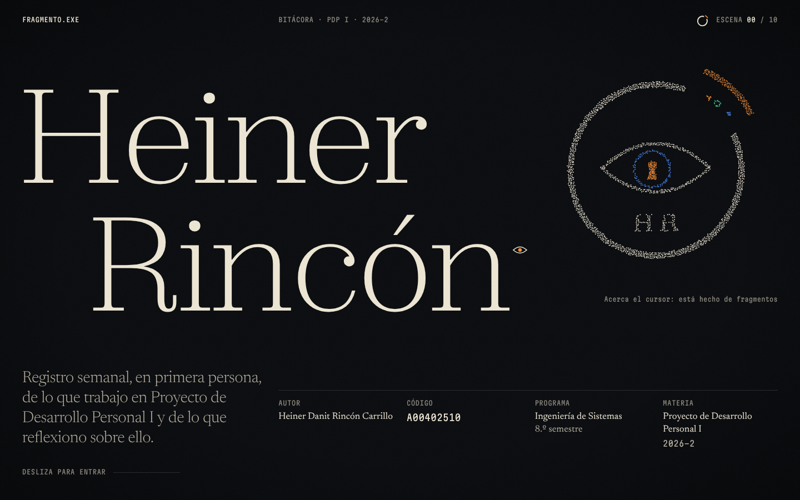
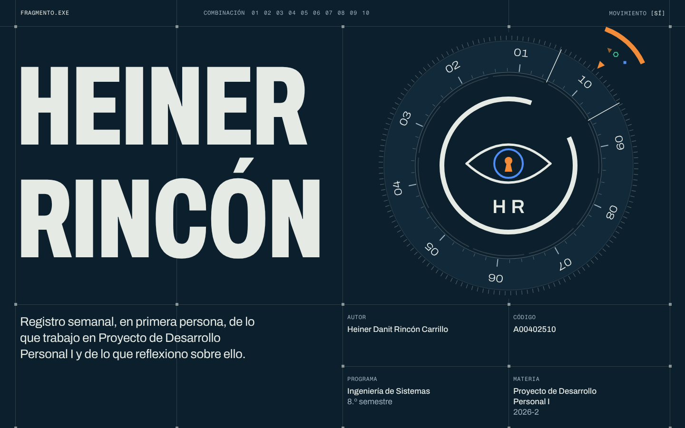

# Crítica independiente · Fase 1 · Ronda 2 (portada + transición a la SEMANA_01)

> Revisión del 16-oct-2026, hecha por un crítico que no participó en la construcción. Solo lectura: no se tocó nada de `site/`.
> Prototipos: **A "Sala de observación"** (`site/lab/direccion-a/`, commit `ac80927`) y **B "Sistema vivo", reorientada a caja fuerte** (`site/lab/direccion-b/`, commit `0b6ec10`).
> Las notas se pusieron **antes** de leer `docs/CRITICA-FASE1.md`. La comparación con la ronda 1 va al final de cada prototipo.

## Método

- `revisar.mjs` a 1440 × 900 y 390 × 844, del 0 al 100 % del scroll, con y sin `prefers-reduced-motion` (prefijos `a`, `a-rm`, `b`, `b-rm`). En los cuatro casos: **0 errores de consola, 0 scroll horizontal, unos 61 fps en reposo**.
- Scripts propios de Playwright (Chromium, `file://`, porque el proxy del entorno no deja pasar `localhost`):
  - entrada a 0,5 s, 1,5 s y 3 s;
  - hover sobre el símbolo y el dial;
  - fps durante 25 golpes de rueda: A 58 fps con el peor cuadro en 37 ms; B 60 fps con el peor en 24 ms;
  - 11 cuadros del pin, entre el 4 % y el 45 % del scroll;
  - recorrido con Tab (10 pulsaciones);
  - 360 × 740 táctil;
  - PDF carta (A: 4 páginas; B: 2);
  - el GIRO de muestra de cada uno (`?demo-giro` en A, botón «Probar calibración» en B).
- Skill `impeccable` (critique y audit) en modo solo revisión. **⚠️ DEGRADED: single-context.** Esta sesión no tiene herramienta de subagentes, así que el juicio visual (evaluación A) se cerró antes de mirar el detector (evaluación B). No se guardó snapshot en `.impeccable/` porque el encargo era no escribir fuera del informe. Preguntas de cierre omitidas: revisión delegada, sin usuario en el bucle.
- `impeccable detect site/lab/direccion-X/` solo corre el regex sobre CSS y JS: **0 hallazgos en ambos**. `detect --json` sobre los `index.html` devuelve `[]`. Es un conteo por debajo de lo real: el contenido lo pinta JS, y en esta ronda no se pudo servir por http para el escaneo con navegador.
- Capturas representativas: `docs/critica/r2-*.png`.

---

## Dirección A · "Sala de observación"

### Notas

| Criterio | Nota | Justificación concreta |
|---|---|---|
| a) No parece plantilla / IA | **7** | La portada tiene autor (`r2-a-01`): Zodiak finísima a unos 240 px, «Heiner / Rincón» escalonado como un *travelling* y el *billing block* de afiche con Newsreader contra Martian Mono. No sale de ningún kit. Lo que baja la nota: (1) el símbolo en reposo ahora es una **nube de puntos** (`a-hover-crop`), y la «HR» punteada queda ilegible: el punteado generativo es justo un tic de "hecho con IA" y pierde la nitidez del vector; (2) las **escuadras en las esquinas** de cada recuadro `[PENDIENTE]` (`a-1440-030`, `-050`, `-075`) son ornamento de HUD que no carga sentido; (3) el «01» gigante en contorno, que luego se rellena, es un recurso editorial muy visto. |
| b) Momento compartible | **9** | **La cámara entra por la cerradura** (`r2-a-02`): el iris azul ocupa la pantalla, la pupila-cerradura con borde naranja de 2 px y, por el hueco, ya se lee la semana 01. Se entiende sin explicación, es ciberseguridad («ver lo que otros no ven») y metacognición (mirar hacia adentro) a la vez, y se ve en móvil igual de bien (`a-360-2`). El GIRO de muestra, con corte a negro y descifrado por bloques marfil (`r2-a-04`), es un segundo momento sólido. |
| c) Concepto | **8** | Cuentan algo: las partículas que arman el símbolo (fragmentos que vuelven al todo), el fragmento que se queda fuera y flota, el iris que sigue al cursor (el observador), la cerradura como puerta de la semana, el corte duro de 130 ms como montaje de *plot twist*, el GIRO como revelación y el mini-símbolo de la claqueta que avanza y late. **Decorativos:** el grano (ahora a 0,065–0,09: se ve en el corte, en reposo apenas), la «luz» de la portada, la apertura del nombre como telón (bonita, pero no dice nada), las escuadras de los recuadros y los contornos de colores del descifrado sobre «Giro» (los rectángulos azules de `r2-a-04` parecen cajas de depuración). **Ritmo y crecimiento**, dos capas del brief, casi no aparecen. |
| d) Tipografía, ritmo, espaciado, detalle | **7,5** | La portada y el GIRO a pantalla completa son de nivel. La cabecera de la semana mejoró con su retícula de afiche (`a-rm-1440-030`). Problemas: (1) el «01» lleno se corta contra la hairline de la cabecera y deja dos bloques marfil mutilados (`r2-a-03`); (2) el título de la semana sale **dos veces**, en el h2 y en el índice lateral (`a-390-030`, abajo); (3) a 360 y 390 la pista «Toca el símbolo: está hecho de fragmentos» queda **apretada en una columna de 4 líneas** contra el borde izquierdo (`a-360-0`, `a-390-000`); (4) durante el zoom, la cabecera muestra «ESCENA» sin valor y el título aún oculto: hay un hueco de unos 300 px hasta que termina el pin (`a-1440-030`). |
| e) Rendimiento y accesibilidad | **7,5** | 58–61 fps; el canvas se detiene al reposar, con DPR acotado y pausa por `visibilitychange`; Zodiak alojada en local con `preload`. Reduced motion impecable: estado final, sin pin, «Bajar a la semana 01» (`a-rm-*`). El Tab llega al índice y al enlace del GIRO, con foco naranja de 2 px. Fallos: (1) el cursor-ojo solo se actualiza con `pointermove`: al bajar con la rueda **se queda pintado** sobre el texto de la semana, junto al cursor nativo (`a-1440-050`, sobre «espero»); (2) el propósito y los créditos se ven a los 0,5 s y luego se ocultan para entrar con fundido (parpadeo en la entrada, `S-a-in` cuadro 1); (3) el PDF no deja una semana por página: la 01 ocupa tres hojas, y con fondos activados la `html` oscura enmarca cada hoja. |
| **Global** | **7,8** | La dirección con alma y con un momento que alguien mostraría. La semana ya no se desinfla, pero falta pulido de detalle. |

### Resumen de `/impeccable critique` (A)

- **Especificidad:** alta en la portada, la cerradura y el GIRO; media en el cuerpo de la semana (escuadras y número gigante con texto al lado).
- **Nielsen (Experience; 7 y 10 n/a):** 1 Estado 3 · 2 Mundo real 4 (la metáfora de sala y escena se entiende sola) · 3 Control 3 · 4 Consistencia 3 · 5 Prevención 3 · 6 Reconocimiento 3 · 8 Estética 3 · 9 Recuperación 3 → **25/32 (bueno)**.
- **Viaje emocional:** sube en la entrada, alcanza el pico en la cerradura y cierra fuerte en el GIRO (corte y descifrado). La regla pico-final ya juega a favor.
- **Fortalezas:** jerarquía de tres voces, una sola idea de cámara y un naranja usado con disciplina (≤ 2 %).
- **Problemas P1:** cursor fantasma con la rueda; pista ilegible en móvil; «01» mutilado; título duplicado.
- **Detector:** 0 hallazgos (solo regex). La ronda 1 marcó por http `kicker-above-heading` (SEMANA_01) y `buried-raster` (grano). El grano sigue siendo casi invisible en reposo.

### Resumen de `/impeccable audit` (A)

| Dimensión | Nota | Hallazgo clave |
|---|---|---|
| Accesibilidad | 3 | Tab completo y foco visible; cursor-ojo fantasma con rueda; `aria-hidden` bien puesto en canvas, corte y grano |
| Rendimiento | 3 | 58 fps en scroll con un pico de 37 ms; canvas pausado; fuentes locales con preload |
| Theming | 3 | Tokens en `:root`; hex fijos en el SVG inline, el mini-símbolo y el cursor |
| Responsive | 3 | Sin desborde a 360; la cerradura funciona en táctil; la pista se rompe a 360/390 |
| Integridad | 3 | Efectos reales (atlas de glifos, máscara SVG del marco, ScrambleText); grano y escuadras son relleno |
| **Total** | **15/20** | Bueno |

### Correcciones priorizadas (A)

1. **[P1] Cursor-ojo fantasma.** Ocultarlo también en `scroll` (o en `lenis.on('scroll')`), según `elementFromPoint` de la última posición, para que nunca quede sobre la lectura. → `/impeccable harden`
2. **[P1] La pista del símbolo en móvil:** en una línea, debajo del símbolo y en el ancho completo, o eliminarla en táctil (el barrido del iris ya enseña). → `/impeccable adapt`
3. **[P1] El símbolo en reposo debe ser el vector nítido**, y las partículas solo al acercarse o tocar. Hoy la «HR» punteada se lee mal y baja la calidad percibida de la pieza central. → `/impeccable polish`
4. **[P2] El «01»:** que la hairline no lo corte a la mitad. Que sangre por el borde de la pantalla, o que entre completo en la cabecera. → `/impeccable layout`
5. **[P2] Quitar el título duplicado** del índice lateral (`indice__titulo`) o sustituirlo por «Semana 01». → `/impeccable distill`
6. **[P2] Quitar las escuadras** de los recuadros `[PENDIENTE]` y los contornos azules del descifrado del GIRO: el corte y los bloques marfil bastan. → `/impeccable quieter`
7. **[P2] Entrada sin parpadeo:** propósito y créditos ocultos desde `html.precarga` en CSS, no desde JS después de las fuentes. → `/impeccable polish`
8. **[P3] Darles un lugar a ritmo y crecimiento:** por ejemplo, que el mini-fragmento de la claqueta y la barra «Desliza para entrar» se lean como el avance real (k/N) en toda la página. → `/impeccable delight`

### Qué cambió frente a la ronda 1 (A)

**Corregido:**
- La semana ya tiene retícula de afiche y la reflexión va como plano.
- El GIRO es una escena a pantalla completa, con pin, corte duro de 130 ms y descifrado a gran tamaño (correcciones 1 y 2).
- Teclado: el enlace del GIRO entra en el orden de Tab (corrección 4).
- `cursor: none` limitado a portada, GIRO y claqueta (corrección 10).
- Zodiak alojada en `fonts/` con `preload` (corrección 5).
- Las partículas respiran en reposo y hay una pista de lectura (corrección 8).
- El mini-símbolo late al pasar de 00 a 01 (corrección 9).
- La impresión ya no deja la página en blanco ni corta letras.

**Sin corregir o a medias:**
- El grano sigue sin justificarse en reposo (corrección 7).
- El «01» hoy se corta (corrección 6).
- La impresión aún no pone una semana por página.

**Problemas nuevos que trajo la ronda:**
- El símbolo punteado en reposo.
- La pista rota en móvil.
- El cursor fantasma.

---

## Dirección B · "Sistema vivo" (caja fuerte)

### Notas

| Criterio | Nota | Justificación concreta |
|---|---|---|
| a) No parece plantilla / IA | **6** | La caja fuerte le dio una identidad que antes no tenía: perilla con estrías, ranura e índice naranja, y números que giran con la perilla como en un dial real (`r2-b-01`). El HUD se depuró: no hay reloj ni coordenadas, y la barra solo dice `COMBINACIÓN 01…10` y `MOVIMIENTO [SÍ]`. Pero el conjunto sigue siendo el «suizo técnico» más repetido de los últimos años: retícula a pantalla completa con nodos cuadrados, mono en mayúsculas y grotesca condensada en caja alta. Además, **las hairlines atraviesan el texto**: la vertical de x = 371 cruza «primera», «Desarrollo» y «reflexiono» en el propósito (`r2-b-01`, `b-rm-1440-030`), y la de x = 720 corta «(DI\|SC)» (`b-1440-100`). Una retícula que choca con el texto se lee como plantilla mal ajustada. |
| b) Momento compartible | **7,5** | **La perilla gira con retenes y la ventana amplía el número que pasa por la ranura** (`r2-b-02`): 04, 05, 06… en Archivo ancho gigante, mientras las celdas de la portada se cierran. Después, el clic: el índice y la luz recorren el anillo, la pupila-cerradura gira un cuarto y la semana se abre por celdas. Es físico y dan ganas de jugar con él. El GIRO calibrado sobre la losa naranja (`r2-b-04`) es el segundo momento. Le falta la claridad instantánea de la cerradura de A. |
| c) Concepto | **7** | Ahora el ojo y la cerradura trabajan: el iris se orienta hacia el cursor, la pupila gira como un cilindro y la etiqueta de inspección dice «CERRADURA · 0 de 10 números marcados». La metáfora de caja fuerte, una semana por número de la combinación, es buena y muy de «trucos bajo la manga». Pero tiene una contradicción: **en la portada la perilla recorre 01→10 y la ventana gigante muestra «06», «07», «09»** (`b-1440-030`, `S-b-f`) cuando solo existe la semana 01. Un profesor lee «semana 06». **Decorativos:** nodos de la retícula, estrías del bisel, tick de 1,2° por número (imperceptible) y el pulso a 124 BPM, que nadie asocia con música. |
| d) Tipografía, ritmo, espaciado, detalle | **7** | Archivo condensado pesado para el nombre y el h2 (contundente), Archivo ancho fino para la cifra, y la tilde de «RINCÓN» ya respira. La semana (`r2-b-03`) es la estructura de lectura más clara de los dos. Fallos: (1) hairlines sobre el texto (ver a); (2) durante el giro, la mitad inferior de la pantalla queda en celdas vacías (`b-1440-050`); (3) las cifras se quedan **color durazno** si se baja y se vuelve a subir: `tlEnc.kill()` corta a medias el tween de color (`S-b-f`, cuadros 04–09); (4) en móvil, el dial acoplado **se monta sobre «A00402510»** (`r2-b-04` a la derecha, `b-390-015`) y deambula a media pantalla entre la portada y la semana (`b-390-030`, `S-b-360`); (5) «Desarrollo Personal / I» deja la «I» huérfana a 390. |
| e) Rendimiento y accesibilidad | **7** | Solo SVG y DOM, 60 fps con el peor cuadro en 24 ms. El control `MOVIMIENTO [SÍ]/[NO]` lleva `aria-pressed` y guarda la preferencia. El modo reducido es completo, con dial estático propio y la inspección apagada (`b-rm-*`). Contraste alto (7,75:1 el secundario). Fallos: (1) con Tab, el foco pasa a «Probar calibración» (y = 1300) **sin que la página se desplace**: el foco queda fuera de la vista (WCAG 2.4.7 y 2.4.11); (2) **el PDF imprime «10»** como número de la semana en lugar de «01»: `girar(0)` calcula `k = 10` (página 2 de `b.pdf`); (3) el GIRO es un `
` y no un encabezado. |
| **Global** | **7,0** | Subió mucho: tiene concepto propio, el ojo trabaja y hay un momento físico. Pero la retícula pisa el texto y el móvil está roto en la transición. |

### Resumen de `/impeccable critique` (B)

- **Especificidad:** media. La perilla de caja fuerte con el símbolo HR es propia; la retícula con nodos, mono y caja alta es intercambiable.
- **Nielsen (Experience; 7 y 10 n/a):** 1 Estado 3 (`COMBINACIÓN 01/10`) · 2 Mundo real 2 (el «06» gigante sugiere otra semana) · 3 Control 4 (toggle de movimiento, saltar) · 4 Consistencia 3 · 5 Prevención 3 · 6 Reconocimiento 3 · 8 Estética 3 · 9 Recuperación 3 → **24/32 (bueno)**.
- **Carga cognitiva:** baja frente a la ronda 1. En la portada compiten nombre, perilla con 10 rótulos y 4 créditos: aceptable.
- **Viaje emocional:** entrada a tempo, giro largo con un valle de celdas vacías, clic y GIRO naranja como final fuerte.
- **Detector:** 0 hallazgos (solo regex; en la ronda 1, por http, también dio 0). Las reglas no captan el patrón retícula-HUD; el juicio visual sí.

### Resumen de `/impeccable audit` (B)

| Dimensión | Nota | Hallazgo clave |
|---|---|---|
| Accesibilidad | 2 | Foco fuera de la vista al tabular; el GIRO sin encabezado; lo demás es sólido |
| Rendimiento | 3 | SVG y DOM, 60 fps; el `will-change` permanente desapareció |
| Theming | 3 | Tokens coherentes, escalones de panel sin sombras |
| Responsive | 2 | El dial acoplado tapa el código y deambula a media pantalla en móvil; «I» huérfana |
| Integridad | 3 | Número de semana falso (06, 10) en pantalla y en impresión; cifras que se quedan durazno |
| **Total** | **13/20** | Aceptable |

### Correcciones priorizadas (B)

1. **[P0] Que la perilla nunca muestre semanas que no existen.** El giro de la portada debe ir a la combinación real (con k semanas publicadas, recorrer 01…k), o la ventana gigante debe mostrar el número solo al encajar. Arreglar también el «10» del PDF. → `/impeccable harden`
2. **[P1] Retícula que no pise texto:** mover el propósito a una celda propia o darle `background: var(--campo)` y un padding que tape las hairlines; lo mismo para `.siguiente__titulo`. → `/impeccable layout`
3. **[P1] Móvil:** el dial acoplado debe ir dentro de la barra (en la `.ranura`) desde el primer píxel, sin trayecto por media pantalla y sin tapar el código. → `/impeccable adapt`
4. **[P1] Foco visible:** al recibir foco un elemento fuera de la vista, desplazar con `lenis.scrollTo(el)` (o no bloquear el scroll nativo de foco). → `/impeccable harden`
5. **[P2] Color de las cifras:** `gsap.set(cifras, { color: … })` al matar `tlEnc`, o animar una variable CSS que siempre se resuelva. → `/impeccable polish`
6. **[P2] Llenar el valle del giro:** que las celdas que se cierran abajo muestren algo del concepto (por ejemplo, la combinación que se va marcando) o acortar el pin. → `/impeccable distill`
7. **[P2] Quitar los nodos cuadrados** de la retícula y dejar solo las líneas que ordenan: es el tic más reconocible. → `/impeccable quieter`
8. **[P3] El GIRO como `<h3>`** y `text-wrap: balance` en los valores de la ficha («Personal I»). → `/impeccable typeset`

### Qué cambió frente a la ronda 1 (B)

**Corregido:**
- El encaje ya es un momento, con giro de vuelta completa, retenes, luz en el anillo, cerradura que gira y celdas que se abren (corrección 1).
- Desapareció la lectura «GIRO DEL BISEL 030,8°» (corrección 2).
- El HUD se recortó: sin reloj y sin coordenadas X/Y (corrección 3).
- El ojo y la cerradura trabajan (corrección 4).
- Inspección apagada en reduced motion (corrección 5).
- La tilde de «RINCÓN» respira (corrección 6).
- La etiqueta de inspección se mantiene en las columnas del dial y no pisa el nombre, aunque tapa parte del fragmento (corrección 7).
- El GIRO calibra en 3 líneas fijas y bien asentado (corrección 8).
- Fuera el `will-change` permanente (corrección 10).

**Sin corregir o empeorado:**
- El móvil sigue tapando contenido; ahora es el código y no «PROGRAMA» (corrección 9).
- La retícula sigue leyéndose como plantilla.

**Problemas nuevos que trajo la ronda:**
- El número de semana falso (06, 10).
- El color durazno que se queda en las cifras.
- El foco fuera de la vista.

---

## Comparación y recomendación final

| | A · Sala de observación | B · Caja fuerte |
|---|---|---|
| a) No plantilla | 7 | 6 |
| b) Momento compartible | 9 (cerradura) | 7,5 (perilla con retenes y clic) |
| c) Concepto | 8 | 7 |
| d) Tipografía y ritmo | 7,5 | 7 |
| e) Rendimiento y accesibilidad | 7,5 | 7 |
| **Global** | **7,8** | **7,0** |

**Recomendación: construir sobre A.** Su momento se entiende en un segundo y sin rótulos, que es exactamente la meta de los 5 segundos. Además, su lenguaje (afiche de cine, serif hairline, penumbra) es el que menos se parece a lo que hoy produce una IA.

B cerró gran parte de la distancia, y la caja fuerte es una idea mejor que el instrumento de la ronda 1. Pero depende de una retícula que la delata como sistema y de un giro que, con una sola semana, muestra números falsos.

Para la mezcla, conviene traer de B tres cosas:
1. **El control `MOVIMIENTO [SÍ]/[NO]`.**
2. **La disciplina de filas** (título a la izquierda, contenido a la derecha) para los bloques de la semana.
3. **La idea de la combinación** como hilo de progreso: en A, la claqueta podría marcar «escena k/N» como números de la combinación que se van encendiendo, sin perilla.

Antes de mostrárselo a Heiner, corregir de A los puntos 1–3 (cursor fantasma, pista en móvil, símbolo nítido en reposo).
