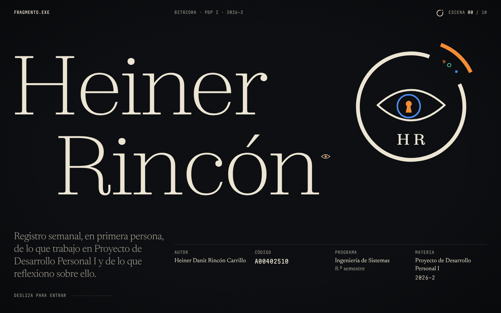
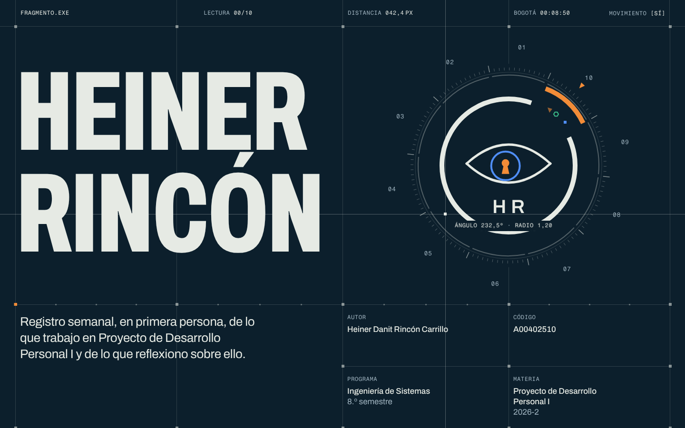

# Crítica independiente · Fase 1 (portada + transición a la SEMANA_01)

> Revisión hecha el 16-oct-2026 por un crítico que no participó en la construcción. Solo lectura: no se tocó nada de `site/`.
> Prototipos: **A "Sala de observación"** (`site/lab/direccion-a/`) y **B "Sistema vivo"** (`site/lab/direccion-b/`).

## Método

- Capturas con `revisar.mjs` a 1440 × 900 y 390 × 844, del 0 al 100 % del scroll, con y sin `prefers-reduced-motion`. Las dos dan 0 errores de consola, 0 scroll horizontal y unos 61 fps en reposo.
- Scripts propios: la entrada fotograma a fotograma (cada 220 ms), el scroll con rueda en 10 pasos midiendo la duración de los cuadros, hover y cursor sobre el símbolo, recorrido con Tab, 360 px, el GIRO de muestra de cada uno, PDF de impresión (carta) y contraste calculado de todos los textos visibles.
- `/impeccable critique` y `/impeccable audit` para cada prototipo, en modo solo revisión. **⚠️ DEGRADED: single-context**: en esta sesión no hay herramienta de subagentes, así que las evaluaciones A y B de critique se hicieron en secuencia (primero el juicio visual y después el detector). No se guardó el snapshot en `.impeccable/` porque el encargo era no escribir fuera del informe.
- `impeccable detect` sobre las carpetas solo hizo el escaneo regex de CSS y JS y no encontró nada. Contra el HTML servido por http (con el Chromium de Playwright), A tuvo 3 hallazgos y B ninguno (detalle abajo).
- Capturas representativas guardadas en `docs/critica/`.

---

## Dirección A · "Sala de observación"

### Notas

| Criterio | Nota | Justificación concreta |
|---|---|---|
| a) No parece plantilla / IA | **7** | La portada tiene autor. Zodiak finísima a ~240 px partida en «Heiner / Rincón» escalonado, más el *billing block* de afiche de cine debajo (`a-01`), no sale de ningún kit. La serif de lectura (Newsreader) contra la mono de créditos sí se siente cine y no "tech". Lo que baja la nota: la claqueta en mono (`FRAGMENTO.EXE · BITÁCORA · PDP I · 2026-2 · ESCENA 00/10`), la etiqueta `SEMANA_01` encima del h2 (el detector la marca como *kicker*), las hairlines de los créditos y un grano al 5 % que no se ve (el detector lo marca como «raster enterrado»). Son los tics que la propia dirección prometía cargar de sentido, y aquí la mitad son decorado. La cabecera de la semana (`a-04`) es una composición editorial correcta pero genérica: número gigante a la izquierda y texto a la derecha. |
| b) Momento compartible | **8** | Sí, y es claro: **entrar por la cerradura** (`a-02`). El ojo crece hasta que el iris azul llena la pantalla, y por el hueco de la pupila ya se lee la semana 01 (`FECHA [PE…`). Es la frase «ver lo que otros no ven» hecha movimiento, y alguien lo mostraría. Segundo candidato: el símbolo que **se desarma en partículas al pasar el cursor**, con la cerradura convertida en una media luna de puntos que sigue al ratón (`a-03`, derecha). |
| c) Concepto | **8** | Casi todo cuenta algo: partículas-glifo (`0 1 < > #`) que se resuelven en el símbolo (fragmentos que vuelven al todo y descifrar), el fragmento naranja que se ensambla aparte (falta una pieza y es él), el cursor-ojo que el iris persigue (el observador observado), la cerradura (ciberseguridad) y el GIRO con descifrado por capas de color (plot twist, sin efecto Matrix). **Decoración:** el grano (invisible a 0,05), la viñeta, la barra de «Desliza para entrar» y el corte a negro del final del pin, que a velocidad normal de scroll no se percibe. El mini-símbolo de la claqueta solo avanza de 00 a 01 y apenas se nota. |
| d) Tipografía, ritmo, espaciado, detalle | **7** | La portada es excelente: jerarquía de tres voces, «8.º» bien escrito y el código en mono tabular. Pero el cuerpo de la semana se cae. En `a-1440-075` los dos bloques flotan en una pantalla casi vacía, sin una retícula que explique por qué el segundo está desplazado 120 px más abajo. El GIRO (`a-1440-100`) es una pantalla negra de 700 px con un recuadro pendiente diminuto arriba a la izquierda. El «01» no es Zodiak 100 hairline como pedía la especificación: se ve de peso medio y pierde el "plano de cine". En el primer cargue en frío, el nombre se pintó en Times hasta que llegó Zodiak desde Fontshare (FOUT visible en la captura de entrada a 2,5 s). |
| e) Rendimiento y accesibilidad | **7** | Mediana de cuadro de 16,7 ms durante el scrub (p95 16,7, 2 cuadros de más de 20 ms). El canvas se apaga al asentarse; IntersectionObserver y visibilitychange están cableados; DPR acotado. Contraste mínimo de 5,57:1 (`--niebla`). Reduced motion bien hecho: sin pin ni partículas, símbolo y «01» en estado final (`a-rm-*`). Fallos: (1) el GIRO va `autoAlpha: 0` hasta el scroll, así que el enlace «Ver el descifrado…» **no entra en el orden de Tab** (con Tab se recorren solo 3 elementos y se vuelve al `body`); (2) `cursor: none` aplicado a `*`; (3) la impresión sale en **3 páginas, la tercera en blanco**, y la página 2 corta la primera letra por la izquierda («ECHA», «PENDIENTE»). |
| **Global** | **7,5** | La dirección con más alma y con el mejor momento. Le falta que la semana esté a la altura de la portada. |

### Resumen de `/impeccable critique` (A)

- **Especificidad:** alta en la portada y la transición; media en la semana (podría ser cualquier blog editorial oscuro).
- **Nielsen (Experience; 7 y 10 n/a):** 1 Estado 3 · 2 Mundo real 3 · 3 Control 3 · 4 Consistencia 3 · 5 Prevención 3 · 6 Reconocimiento 3 · 8 Estética 3 · 9 Recuperación 3 → **24/32 (bueno)**.
- **Viaje emocional:** el pico llega en la cerradura (escena 2 de 4) y el final se desinfla. Por la regla pico-final, la última impresión hoy es una pantalla negra con un `[PENDIENTE]`.
- **Detector (http):** `kicker-above-heading` (SEMANA_01 sobre el h2), real pero defendible porque es dato de secuencia; `buried-raster` (grano al 0,05), real; `oversized-h1` (214 px y 61 caracteres), **falso positivo**: cuenta el sufijo `sr-only` del h1.

### Resumen de `/impeccable audit` (A)

| Dimensión | Nota | Hallazgo clave |
|---|---|---|
| Accesibilidad | 3 | El GIRO oculto con `visibility` deja el enlace fuera del Tab; `cursor:none` global |
| Rendimiento | 3 | 60 fps; Zodiak desde cdn.fontshare.com sin preload, con FOUT en cargue frío |
| Theming | 3 | Tokens en `:root`; colores fijos en el SVG del cursor y del mini-símbolo |
| Responsive | 3 | 390 y 360 sin desborde; la cerradura funciona en móvil (`a-390-030`) |
| Integridad | 3 | Los efectos son reales (canvas con atlas de glifos, máscara SVG, descifrado por clases) |
| **Total** | **15/20** | Bueno |

### Correcciones priorizadas (A)

1. **[P1] Que el final de la semana esté a la altura del principio.** El cuerpo y el GIRO necesitan una composición con intención: retícula de afiche, la reflexión como plano, y el GIRO a pantalla completa con el corte a negro que de verdad se sienta (más pin, corte duro). → **/impeccable bolder** (y `/impeccable layout`).
2. **[P1] Hacer visible el corte de montaje.** Hoy el `div.corte` dura 0,2 unidades de un scrub y no se percibe. Debe ser un corte con tiempo (no scrub), de 1 a 2 cuadros negros más un golpe de grano, disparado al cruzar el umbral. → `/impeccable animate`.
3. **[P1] Arreglar la impresión:** eliminar la tercera página en blanco y el recorte izquierdo de la página 2 (revisar `.pin-spacer`, `margin-left`/`translate` residuales y `.semana__numero`). → `/impeccable harden`.
4. **[P1] Teclado:** no esconder el GIRO con `visibility`/`autoAlpha`; usar solo `opacity` o hacerlo visible al recibir foco. → `/impeccable harden`.
5. **[P2] Fuentes:** `preload` del woff2 de Zodiak, o alojarlo en `site/assets/` (Cloudflare lo sirve igual), para que el nombre nunca se vea en Times. → `/impeccable optimize`.
6. **[P2] El «01» como plano de cine de verdad:** Zodiak 100 a 36vw, recortado por el borde, con el *clip-path* de proyección más lento. → `/impeccable typeset`.
7. **[P2] Grano: que exista o que se quite.** A 0,05 no se ve; subirlo a 0,08–0,10 solo en el corte o eliminarlo. → `/impeccable quieter` o `polish`.
8. **[P2] Llevar la interacción de partículas al centro.** Que el cursor la descubra sin buscarla: mostrar las partículas también en el reposo de la portada (una respiración leve) y darle una pista de lectura. → **/impeccable overdrive**.
9. **[P3] El mini-símbolo de la claqueta debería celebrar** el paso 00→01 (un pulso naranja); hoy cambia sin que nadie lo vea. → `/impeccable delight`.
10. **[P3] `cursor: none` solo en la portada**, no en `*`, y nativo sobre los textos largos de la semana. → `/impeccable polish`.

### Veredicto A

**Recomendada como base.** Tiene la idea más fuerte, el momento más compartible y la tipografía más "dirigida". Lo que falla (cuerpo de la semana, GIRO, impresión) se corrige; el concepto no hay que reinventarlo.

---

## Dirección B · "Sistema vivo"

### Notas

| Criterio | Nota | Justificación concreta |
|---|---|---|
| a) No parece plantilla / IA | **5** | Es la estética de "retícula técnica con nodos" más reconocible de los últimos dos años: hairlines a pantalla completa con nodos cuadrados, mono en mayúsculas en toda la barra (`LECTURA 00/10 · DISTANCIA 042,4 PX · BOGOTÁ 00:08:50 · MOVIMIENTO [SÍ]`), bisel graduado con ticks y una mira con `ÁNGULO 232,5° · RADIO 1,20` (`b-01`). Cada pieza tiene excusa en la especificación, pero la suma se lee como HUD, justo lo que la dirección decía no ser. Lo salvan el nombre en Archivo condensado y pesado, la revelación celda por celda (`b-02`) y la losa naranja del GIRO (`b-04`). |
| b) Momento compartible | **6** | El momento declarado (el dial gira y la semana encaja) **no se lee como momento**. El bisel gira 36°, el fragmento se mueve 3 px (de 042,4 a 038,2 px, imperceptible) y el «clic» es un retén de 0,8°. En `b-1440-015/030` se ven dos pantallas de retícula vacía con un número gigante `030,8°` («GIRO DEL BISEL») que no le dice nada a un profesor. Lo que sí mostraría alguien: **el nombre que se arma por celdas a tempo** (`b-02`, «HEINER» con la mitad derecha aún sin abrir) y **el GIRO que inunda la celda de naranja y ensancha la frase** (calibración `wdth` 62→100). |
| c) Concepto | **6** | Lo que cuenta: el dial como crecimiento medible, el nombre por fragmentos (ensamblaje y ritmo) y el GIRO como señal que se enfoca. **Decoración disfrazada de dato:** el reloj de Bogotá con segundos (verdadero pero irrelevante para una bitácora), la mira con coordenadas `X 0300 · Y 0300` y ángulo/radio, la lectura gigante «GIRO DEL BISEL 030,8°», el secuenciador a 124 BPM (un punto naranja de 6 px que nadie asocia con música) y `DISTANCIA` en px, que mide una animación de 3 px. El ojo y la cerradura del símbolo, que son el corazón del concepto, aquí no hacen nada. |
| d) Tipografía, ritmo, espaciado, detalle | **7** | La retícula ordena de verdad: la semana (`b-1440-075`) es la mejor composición de cuerpo de los dos prototipos, con filas tituladas y celdas con fondo escalonado. El h2 en Archivo condensado es contundente. Fallos de detalle: la tilde de «RINCÓN» queda a 2–3 px de la base de la E de «HEINER» (interlineado demasiado apretado); la etiqueta de la mira se monta sobre «HR» y el anillo (`b-01`, y en reduced motion `b-rm-1440-050`); la frase del GIRO pasa de 2 a 3 líneas al calibrarse y queda pegada arriba a la izquierda de una losa naranja de 380 px vacía. |
| e) Rendimiento y accesibilidad | **8** | Mediana de cuadro de 16,7 ms (p95 16,8, máx. 33 ms). Todo es SVG y DOM, sin canvas. Control real `MOVIMIENTO [SÍ]/[NO]` con `aria-pressed` y preferencia guardada (try/catch). El modo reducido es completo, con dial estático propio en R(1) (`b-rm-*`). Contraste mínimo de texto secundario de 7,75:1. La impresión sale limpia en 2 páginas. Fallos: la mira sigue activa y con `cursor: none` en reduced motion; `will-change: transform` permanente en 5 elementos; el reloj reescribe el DOM cada segundo durante toda la visita. |
| **Global** | **6,5** | La más correcta técnicamente y la mejor en el cuerpo de la semana, pero la menos memorable y la más expuesta a «esto lo hizo una IA». |

### Resumen de `/impeccable critique` (B)

- **Especificidad:** media-baja. Con otro símbolo en el dial, la misma página serviría para una consultora de datos o un estudio de arquitectura.
- **Nielsen (Experience; 7 y 10 n/a):** 1 Estado 3 · 2 Mundo real 2 (DISTANCIA en px, ÁNGULO y RADIO son jerga sin referente) · 3 Control 4 (toggle de movimiento, saltar) · 4 Consistencia 3 · 5 Prevención 3 · 6 Reconocimiento 3 · 8 Estética 2 (ruido de lecturas) · 9 Recuperación 3 → **23/32 (bueno)**.
- **Carga cognitiva:** en la portada compiten 4 lecturas de la barra, 10 rótulos del bisel, la mira con su lectura, el nombre, el propósito y 4 créditos: más de 4 focos a la vez.
- **Viaje emocional:** buena entrada (celdas a tempo), valle largo en la transición (retícula vacía) y final fuerte con el naranja.
- **Detector (http):** 0 hallazgos. Las reglas de "slop" no detectan el patrón HUD; el juicio visual sí.

### Resumen de `/impeccable audit` (B)

| Dimensión | Nota | Hallazgo clave |
|---|---|---|
| Accesibilidad | 3 | Mira y `cursor:none` activas en reduced motion; el resto es sólido |
| Rendimiento | 3 | `will-change` permanente; reloj cada 1 s; secuenciador con `setInterval` (se pausa bien) |
| Theming | 3 | Tokens coherentes, escalones de panel sin sombras |
| Responsive | 3 | En móvil el dial queda fijo arriba y el contenido pasa por debajo; a 390 se corta «PROGRAMA» bajo la caja del dial (`b-390-030`) |
| Integridad | 2 | Varias "lecturas" que no informan nada al lector |
| **Total** | **14/20** | Bueno |

### Correcciones priorizadas (B)

1. **[P0] Que el encaje sea un momento.** El giro tiene que ser grande y legible: el bisel recorre un segmento entero con un detent visible, el fragmento avanza una distancia que se vea (no 3 px) y el encaje dispara luz en todo el anillo. → **/impeccable overdrive**.
2. **[P1] Quitar la lectura «GIRO DEL BISEL 030,8°»** y las dos pantallas de retícula vacía de la transición: acortar el pin o llenarlo con el cierre y la apertura de celdas. → `/impeccable distill`.
3. **[P1] Recortar el HUD:** fuera el reloj de Bogotá y las coordenadas X/Y de la mira. Si la mira se queda, que solo diga algo sobre el símbolo («distancia al encaje»). → `/impeccable quieter`.
4. **[P1] Darle trabajo al ojo y a la cerradura.** Hoy el símbolo es un reloj; el observador desapareció del concepto. → **/impeccable bolder**.
5. **[P1] Mira desactivada en reduced motion y en `MOVIMIENTO [NO]`**, con el cursor nativo. → `/impeccable harden`.
6. **[P2] Interlineado del nombre:** subir el `line-height` o bajar «RINCÓN» para que la tilde respire respecto a «HEINER». → `/impeccable typeset`.
7. **[P2] La etiqueta de la mira nunca encima del símbolo:** que cambie de lado cerca del dial. → `/impeccable polish`.
8. **[P2] GIRO:** fijar el número de líneas durante la calibración y centrar ópticamente la frase en la losa. → `/impeccable layout`.
9. **[P2] Móvil:** que el dial fijo no tape contenido al hacer scroll (`b-390-030`). → `/impeccable adapt`.
10. **[P3] `will-change` solo durante las animaciones**, y el reloj fuera (ver 3). → `/impeccable optimize`.

### Veredicto B

**No como dirección principal.** Es impecable como ingeniería y su semana es la mejor organizada, pero no cumple la meta de los 5 segundos («propósito, intención y ganas»). Se siente instrumento, no persona. Para la mezcla conviene rescatar tres cosas: **la revelación del nombre por celdas a tempo**, **la losa naranja del GIRO con la calibración de ancho** y **la retícula del cuerpo de la semana** como estructura de lectura.

---

## Comparación y recomendación

| | A · Sala de observación | B · Sistema vivo |
|---|---|---|
| a) No plantilla | 7 | 5 |
| b) Momento compartible | 8 (cerradura) | 6 (nombre por celdas / GIRO naranja) |
| c) Concepto | 8 | 6 |
| d) Tipografía y ritmo | 7 | 7 |
| e) Rendimiento y accesibilidad | 7 | 8 |
| **Global** | **7,5** | **6,5** |

**Recomendación:** construir sobre **A**. Para el cuerpo de la semana, tomar de B la disciplina de retícula, filas con título a la izquierda y contenido a la derecha, sin hairlines decorativas. Como alternativa de GIRO, tomar la idea de «inundar de luz»: un corte a negro y una frase que se descifra, sobre marfil invertido, en vez de naranja. Antes de mostrárselo a Heiner, corregir de A los puntos 1–4 (semana y GIRO con `/impeccable bolder`, corte visible, impresión y teclado).
